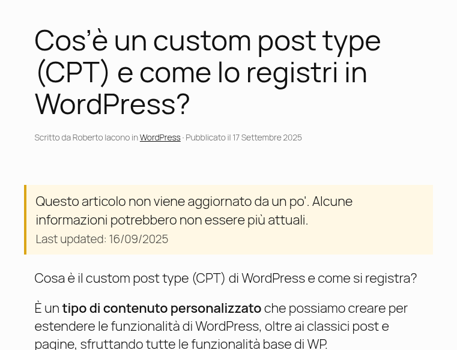
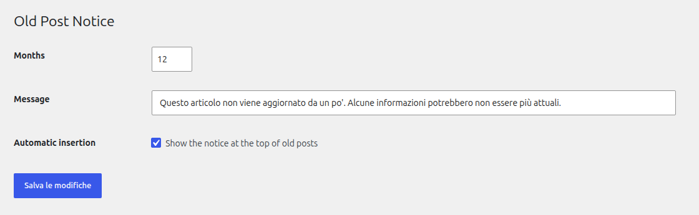

# RIACO Old Post Notice

Plugin WordPress di esempio che mostra un avviso in cima agli articoli non aggiornati da un certo numero di mesi.

È il plugin che costruiamo passo passo nella guida [Come sviluppare un plugin WordPress: guida per sviluppatori (con esempio)](https://robertoiacono.it/sviluppare-plugin-wordpress/).



## Cosa trovi nel codice

- Header del plugin e blocco dell'accesso diretto (`ABSPATH`)
- Un filter (`the_content`) e una action (`wp_enqueue_scripts`)
- Pagina di impostazioni con la Settings API
- Shortcode `[riaco_old_notice]`
- Sanitizzazione, escape, capability e nonce
- Hook di attivazione e `uninstall.php`
- Testi pronti per la traduzione (text domain `riaco-old-post-notice`)

## Installazione

1. Scarica lo zip del repository (`Code > Download ZIP`) oppure clonalo in `wp-content/plugins/`:

   ```
   git clone https://github.com/roberiacono/riaco-old-post-notice.git
   ```

2. Attiva il plugin da `Plugin > Plugin installati`.
3. Configuralo da `Impostazioni > Old Post Notice`.

## Impostazioni

| Opzione | Default | Descrizione |
|---|---|---|
| Months | 12 | Dopo quanti mesi dall'ultimo aggiornamento compare l'avviso |
| Message | testo in inglese | Il messaggio mostrato nell'avviso |
| Automatic insertion | attivo | Inserisce l'avviso in cima agli articoli. Se lo disattivi, usa lo shortcode |



## Requisiti

- WordPress 6.5 o superiore
- PHP 7.4 o superiore

## Licenza

GPL-2.0-or-later. Vedi [LICENSE](LICENSE).
